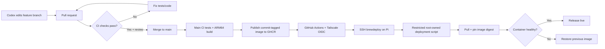

# CI/CD flow

Actual workflow files: .github/workflows/ci.yml and publish.yml. Deploy script is installed on the Pi at /usr/local/sbin/brewery-deploy; proposed infrastructure/deployment/ sources must not overwrite it without separate validation.

This mechanism is event-driven. Production does not poll GitHub or GHCR for releases.
