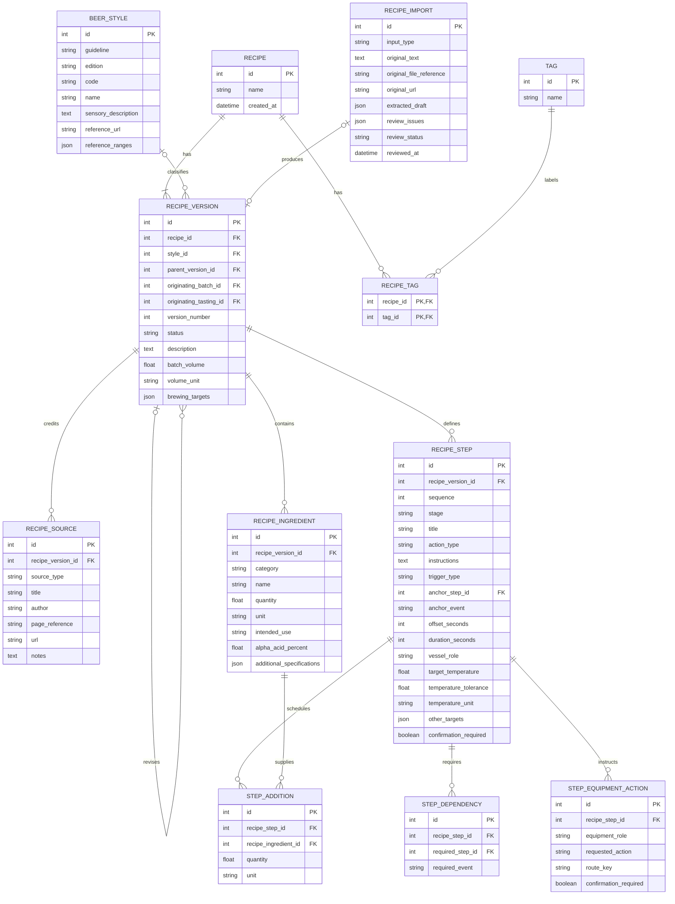
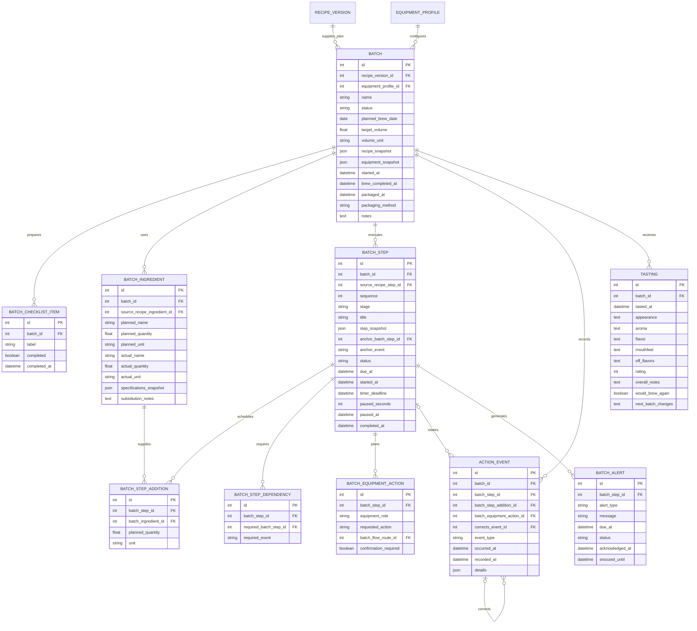
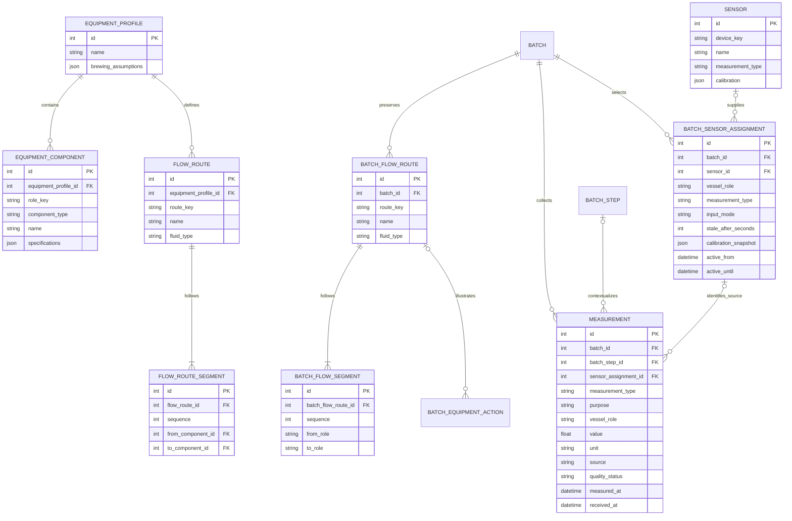

# Target data model
Source baseline: 2026-10-09 (America/Chicago). Status: target logical design; not implemented in this repository.
These are the latest three ERDs from the corrected design. Earlier ERDs are superseded. PK = primary key; FK = foreign key. Optional references and cross-view relationships require the rules in validation-requirements.md.

## Recipes and reusable brewing plans

## Batch setup, execution, and tasting

## Equipment, graphics, and measurements

## Implementation notes

- ERDs are logical design, not SQL DDL. JSON schemas must be defined before implementation.
- Recipe imports produce at most one initial version; track that link with a unique nullable foreign key during implementation.
- Anchor, dependency, originating batch/tasting, and route endpoint references are included as fields; not every edge is drawn to keep the views readable.
- Snapshots preserve targets, instructions, style classification/reference, source details, ingredient specifications, and equipment configuration.
- Batch tables are authoritative for execution; published recipe versions are immutable.
- Route graphics depict planned fluid paths; confirmed equipment states come from action events. The selected mash tun is an insulated cooler with no mash recirculation; omit HERMS/RIMS routes.
- Temperature freshness, timers, beer age, ratings, and comparisons are derived from stored values/timestamps.
- Successful alert acknowledgement is distinct from confirming its physical action.

## Related documentation

- [Acceptance scenarios and validation rules](../requirements/acceptance-scenarios.md)
- [Current implementation status](../plan/status.md)
- [Source provenance](../references/README.md)
