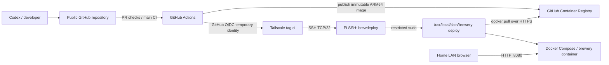

# Network and deployment topology

## Implemented boundaries
- Pi: appHomebrew; Tailscale address 100.117.8.59.
- Pi runs Docker Compose and pulls immutable GHCR images. No periodic GitHub polling.
- Root-owned host configuration: /opt/beer-brewing-app/compose.yaml and .env.
- Production release executes only after successful main CI and image publish.
- No inbound router port forwarding is required.

## Security notes
- GitHub Actions secrets store OIDC client ID, audience, and restricted deploy SSH private key.
- GitHub Actions SSH validates the pinned Ed25519 host fingerprint.
- Tailscale ACL permits tag:ci -> Pi:22; administrative access separately controlled.
- Current browser HTTP :8080 is not encrypted. Keep the web application on a trusted private LAN until HTTPS/authentication are added.
- Avoid publishing real secrets, public web exposure, or live brewery data.
