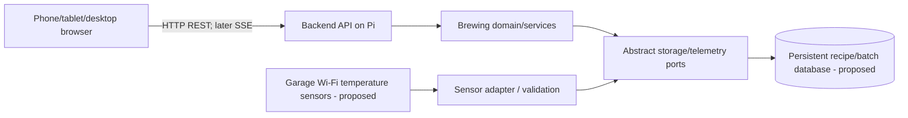

# System architecture

Knowledge-base links: [product scope](../requirements/product-scope.md), [target data model](data-model.md), [current development evidence](../plan/status.md), and [open decisions](../plan/open-decisions.md). Runtime/deployment statements below record the repository baseline; they are not a fresh inspection of the Pi.

## Implemented today
- Public repository: corybeyer/beer-brewing-app; default branch: main.
- GitHub Actions: pull-request CI, ARM64 image build/publish after passing main CI, Tailscale+SSH deployment.
- Registry: ghcr.io/corybeyer/beer-brewing-app, immutable image digest on production.
- Raspberry Pi 5, 16 GB, SSD boot; hostname appHomebrew; locally hosted on port 8080.
- Deployment: GitHub OIDC to Tailscale, tag:ci access to Pi port 22, brewdeploy SSH identity, privileged root-owned deploy script with health/rollback.
- Current application: the React frontend and FastAPI API run with private PostgreSQL under the installed production deployer. Root `app.py` remains the retained health-only rollback service. No brewing API features yet.

## Application components
- Development backend: Python FastAPI bootstrap under `apps/api/brewery_api/`, with separate liveness and schema readiness endpoints; the installed production runtime also serves built frontend assets on port 8080.
- Data: PostgreSQL 17 with SQLAlchemy, Psycopg, and Alembic, selected in [ADR-0003](decisions/0003-postgresql-foundation.md). The development baseline creates revision tracking only; development and production use the six-table `0002_recipe_drafts` schema. See [draft storage and rollout limits](recipe-draft-storage.md). See [setup and migration guidance](backend-foundation.md).
- Frontend: React/TypeScript application in `apps/web`, reusable UI in `packages/ui`, tokens/icons/global styling in `packages/design-system`, and transport contracts/client in `packages/communications`.
- Telemetry: sensor adapters plus eventual MQTT broker, subject to hardware confirmation.
- Internal orchestration: stage/timer/events, with manual brewer confirmation.
- Domain: `brewery_domain.recipe_plan` implements pure version-local reference, dependency/anchor graph, and ingredient-portion validation. It is not yet invoked by a brewing API.
- Design and integrations are separate; no sensor protocol logic in the domain.

## Separation of concerns
Domain -> ports/interfaces (abstract). Database, integrations, API, and infrastructure implement or use ports. UI talks to API contracts, not directly to storage or sensors.

## Runtime communication

## Status
The brewer installed the UI/API and PostgreSQL foundation from commit `2843c0a1b2eee0892fe63a7809decac0b20b9fe7`; liveness, database readiness, frontend serving, and the enabled/active backup timer were checked on November 7, 2026. See [current evidence](../plan/status.md#pi-adoption-and-first-m2-domain-slice). The diagram remains the target business architecture: recipe persistence is deployed at `2df377693d647aa87ec0b98d5470d78fe93c379c`; brewing API workflows and sensors are not implemented. Whole-host recovery remains unverified.

The [recipe-schema adoption evidence](../plan/status.md#verified-production-recipe-schema-adoption) records the subsequent operations update, automatic schema rollout, and verified post-migration snapshot backup.
