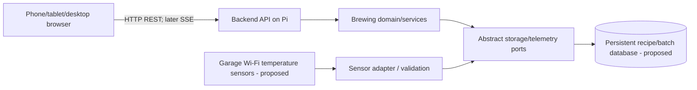

# System architecture

Knowledge-base links: [product scope](../requirements/product-scope.md), [target data model](data-model.md), [current development evidence](../plan/status.md), and [open decisions](../plan/open-decisions.md). Runtime/deployment statements below record the repository baseline; they are not a fresh inspection of the Pi.

## Implemented today
- Public repository: corybeyer/beer-brewing-app; default branch: main.
- GitHub Actions: pull-request CI, ARM64 image build/publish after passing main CI, Tailscale+SSH deployment.
- Registry: ghcr.io/corybeyer/beer-brewing-app, immutable image digest on production.
- Raspberry Pi 5, 16 GB, SSD boot; hostname appHomebrew; locally hosted on port 8080.
- Deployment: GitHub OIDC to Tailscale, tag:ci access to Pi port 22, brewdeploy SSH identity, privileged root-owned deploy script with health/rollback.
- Current application: Python standard-library /health smoke test, managed by Docker Compose. No brewery business features yet.

## Application components
- Development backend: Python FastAPI bootstrap under `apps/api/brewery_api/`, with separate liveness and schema readiness endpoints; production still uses root `app.py`.
- Data: PostgreSQL 17 with SQLAlchemy, Psycopg, and Alembic, selected in [ADR-0003](decisions/0003-postgresql-foundation.md). The development baseline creates revision tracking only; business tables are not implemented. See [setup and migration guidance](backend-foundation.md).
- Frontend: React/TypeScript application in `apps/web`, reusable UI in `packages/ui`, tokens/icons/global styling in `packages/design-system`, and transport contracts/client in `packages/communications`.
- Telemetry: sensor adapters plus eventual MQTT broker, subject to hardware confirmation.
- Internal orchestration: stage/timer/events, with manual brewer confirmation.
- Design and integrations are separate; no sensor protocol logic in the domain.

## Separation of concerns
Domain -> ports/interfaces (abstract). Database, integrations, API, and infrastructure implement or use ports. UI talks to API contracts, not directly to storage or sensors.

## Runtime communication

## Status
Only the existing health service and CI/CD pathway are recorded as deployed. The PostgreSQL/backend foundation is for development and has not replaced production. This diagram remains the target business architecture; the frontend is an isolated development preview, while brewing domain services and sensors are not implemented.
