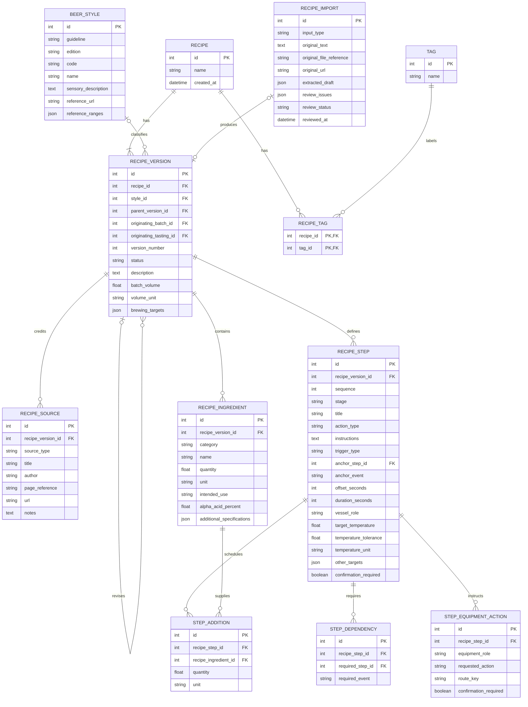
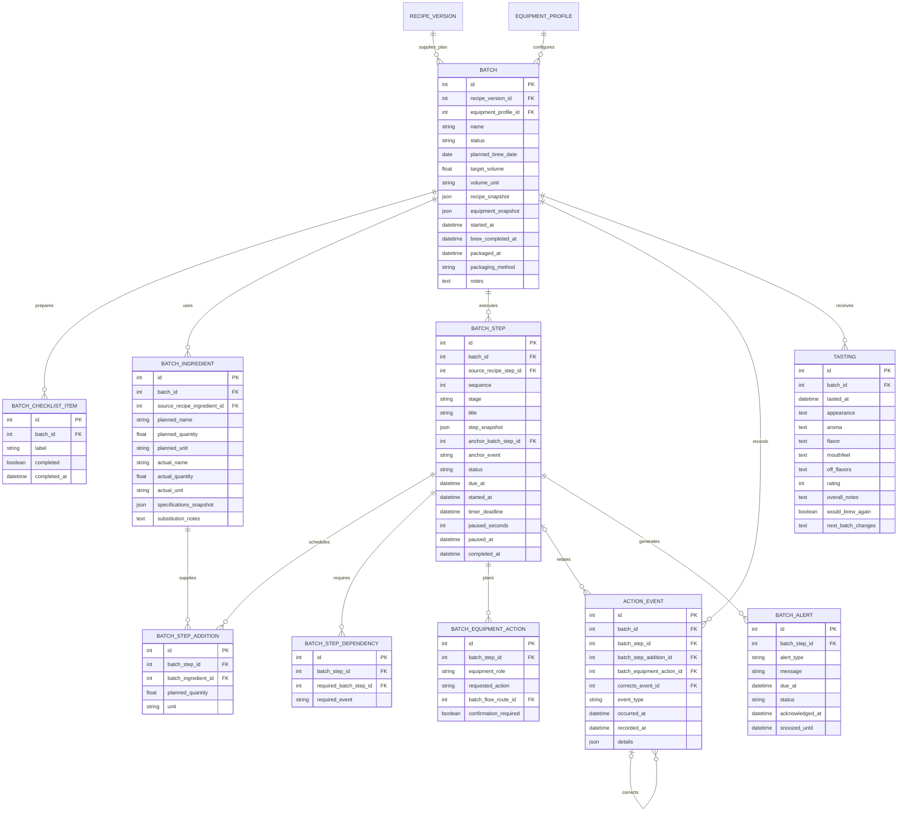
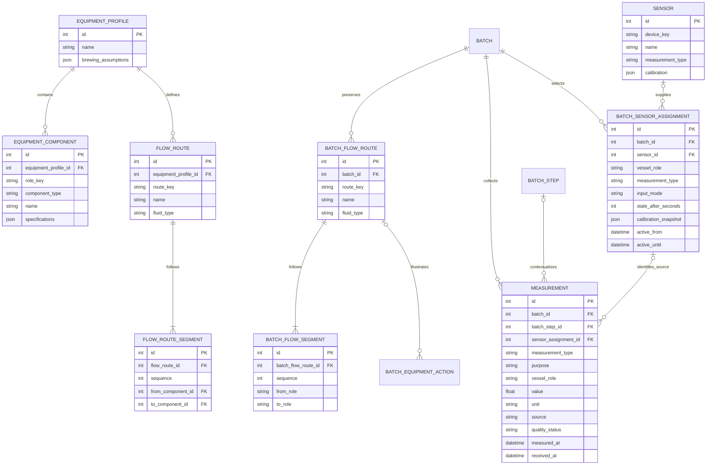

# Home Brewery Setup — Project Reference

Design baseline: October 9, 2026 (America/Chicago).
Status: approved design plus first runnable manual prototype (October 10, 2026). Live sensors and the full production ERD are not implemented.

## Start here in a future session

Read this file, decisions-and-scope.md, database/current-erd.md, and validation-requirements.md before proposing or implementing changes. This package is the consolidated reference for the app design. The corrected three-part ERD supersedes the earlier single ERD.

Do not infer that a feature is implemented because it appears in a wireframe. Mockups contain sample data. Preserve the agreed scope and mark new choices as proposals until accepted.

## Contents

- decisions-and-scope.md: agreed architecture, boundaries, open decisions, and wireframe-to-data coverage.
- database/current-erd.md: latest ERDs with fields and implementation notes.
- database/*.mmd: three editable Mermaid diagram sources.
- validation-requirements.md: integrity rules, workflow validation, and meaningful acceptance scenarios.
- wireframes/: all six app wireframes created in this session.
- PROJECT_REFERENCE.md: consolidated text reference suitable for adding as a Project file.
- manifest.json: file inventory and checksums.

## Wireframes

1. 01-brew-day-dashboard.png — live temperatures, timers, small graphics, current action, and next reminders.
2. 02-recipe-steps.png — ordered steps, timing anchors, ingredient links, and confirmations.
3. 03-batch-review-tastings.png — planned/actual results and repeated tasting records.
4. 04-recipe-library-ingredients.png — recipe search, import proposals, sources, and ingredient entry.
5. 05-recipe-overview-style.png — searchable BJCP classification, editable targets, and tags.
6. 06-batch-setup.png — recipe/equipment review, preparation checks, substitutions, and sensor/manual inputs.

## Important image corrections

- The dashboard includes a HERMS coil. HERMS was explicitly left undecided; replace that route with the chosen equipment layout during implementation.
- The first dashboard has inconsistent step numbering between its header and step strip; final numbers must derive from the batch's actual steps.
- The phone recipe-step mockup omits intermediate steps for illustration; the app must show every step in order.
- Manual readings can support recommendations when entered and validated, but cannot detect a temperature change between entries. The batch-setup phrase “No automatic kettle alerts” means no continuous sensor-triggered detection.
- The batch-review image includes an internal instruction under its revision button. Remove that line from the product UI; creating a revision must preserve history regardless.
- The library's imported-text caption has a rendering defect. Final UI text: “Review extracted ingredients and steps before saving.”
- Import modes are proposed interfaces, not verified website/file parsing capabilities.

## Using this across ChatGPT sessions

Add PROJECT_REFERENCE.md and the six images to the Home Brewery Setup Project's files. The ZIP retains the complete folder structure and editable diagrams. Saving this package does not itself attach it to the ChatGPT Project or guarantee automatic context loading in another chat.

---

# Decisions and scope

## Agreed equipment direction

Five-gallon all-grain batches; three vessels (HLT, mash tun, boil kettle); outdoor propane; two burners; two pumps; manual heating, pump switches, valves, and hose routing; immersion chilling. HERMS remains undecided.

## Agreed app direction

Custom locally hosted app on the user's Raspberry Pi 4 with 4 GB RAM. Responsive browser interface for phone, tablet, and computer on home Wi-Fi. Proposed implementation stack accepted for planning: Python/FastAPI and SQLite.

Server owns session state and timer deadlines. Closing a browser does not stop a brew session. The initial system advises and records; the brewer performs and confirms physical actions.

Recipes support manual creation, personal experiments, and reviewed imports from books or websites. Preserve source attribution and original supplied material. Recipes have ingredients, targets, ordered steps, durations, temperature targets, equipment instructions, additions, and relative reminders.

The brew-day dashboard shows measured temperatures, target temperatures, elapsed/remaining times, temperature trends, small vessel/flow graphics, current instructions, and upcoming actions. Readings and brewer-confirmed equipment status are distinct.

Each batch preserves the recipe version and equipment settings used. Log actual times, ingredient substitutions, measurements, deviations, corrections, and notes. Multiple tastings attach to each batch, with observations, ratings, and suggestions for later recipe revisions.

## Recipe classification

Searchable BJCP dropdown, guideline edition and code preserved. BJCP 2021 18B American Pale Ale is the wireframe example. Allow Unclassified / Custom. Recipe name and personal tags are free text; source is independent of style. Style ranges are references, not enforced limits.

Official reference: https://www.bjcp.org/beer-styles/beer-style-guidelines/
Example style: https://styles.bjcp.org/bjcp-2021-beer/18/18b-american-pale-ale

## Screen-to-data coverage

| Screen/component | Database support |
|---|---|
| Library search, drafts, versions | RECIPE, RECIPE_VERSION |
| Tags and style filters | TAG, RECIPE_TAG, BEER_STYLE |
| Books, websites, personal sources | RECIPE_SOURCE |
| Import originals, draft extraction, review | RECIPE_IMPORT |
| Grain, hops, yeast, additions | RECIPE_INGREDIENT |
| Ingredient portions and schedules | STEP_ADDITION, BATCH_STEP_ADDITION |
| Ordered steps, stages, targets, anchors | RECIPE_STEP, BATCH_STEP |
| Required prior confirmations | STEP_DEPENDENCY, BATCH_STEP_DEPENDENCY |
| Setup dates, batch name, target volume | BATCH |
| Ingredient readiness checkboxes | BATCH_CHECKLIST_ITEM |
| Substitutions and actual quantities | BATCH_INGREDIENT |
| Equipment and planned graphic routes | EQUIPMENT_PROFILE, EQUIPMENT_COMPONENT, FLOW_ROUTE, FLOW_ROUTE_SEGMENT |
| Historical batch routes | BATCH_FLOW_ROUTE, BATCH_FLOW_SEGMENT |
| Equipment action instructions | STEP_EQUIPMENT_ACTION, BATCH_EQUIPMENT_ACTION |
| Manual pump/burner/transfer confirmations | ACTION_EVENT |
| Persistent reminder state | BATCH_ALERT |
| Sensor/manual choices and freshness | SENSOR, BATCH_SENSOR_ASSIGNMENT |
| Temperature trends, gravity, pH, volumes | MEASUREMENT |
| Brew notes and correction history | BATCH, ACTION_EVENT |
| Planned versus actual comparisons | BATCH snapshots, BATCH_INGREDIENT, BATCH_STEP, MEASUREMENT |
| Tasting timeline, beer age, latest rating | TASTING, BATCH.packaged_at |
| Recipe improvement provenance | RECIPE_VERSION parent/version and originating batch/tasting |

## Open implementation choices

- Exact temperature probes, gateway, transport protocol, sampling frequency, stale thresholds, and Wi-Fi reach.
- Frontend framework and visual asset implementation.
- Reliable alert delivery when phone is locked; browser-only display is insufficient as an assumed solution.
- Import parsers, photo/OCR extraction, and any AI assistance; confirm capabilities and whether they need internet access.
- Detailed JSON schemas for brewing targets, specifications, snapshots, and event payloads.
- Unit normalization, enumerations, retention policy, database migrations, backup location, and restore procedure.
- Timer pause semantics: support individual timer pauses explicitly; do not assume pausing the interface pauses physical brewing.

## Build sequence

1. Recipe entry, versioning, steps, and classification — basic manual prototype implemented; full catalog/source schema pending.
2. Manual brew session: timers, confirmations, measurements, batch review, and tasting journal.
3. Temperature sensors and freshness/quality handling.
4. Comparisons and reviewed import enhancements.

Test a simulated brew before integrating sensors. Automatic hardware control is outside the initial scope.

---

# Home Brewery Setup — Current ERDs
Baseline: 2026-10-09 (America/Chicago). Status: agreed design, not an implemented database.
These are the latest three ERDs from the corrected design. Earlier ERDs are superseded. PK = primary key; FK = foreign key. Optional references and cross-view relationships require the rules in validation-requirements.md.

## Recipes and reusable brewing plans

## Batch setup, execution, and tasting

## Equipment, graphics, and measurements

## Implementation notes

- ERDs are logical design, not SQL DDL. JSON schemas must be defined before implementation.
- Recipe imports produce at most one initial version; track that link with a unique nullable foreign key during implementation.
- Anchor, dependency, originating batch/tasting, and route endpoint references are included as fields; not every edge is drawn to keep the views readable.
- Snapshots preserve targets, instructions, style classification/reference, source details, ingredient specifications, and equipment configuration.
- Batch tables are authoritative for execution; published recipe versions are immutable.
- Route graphics depict planned fluid paths; confirmed equipment states come from action events. HERMS is not selected.
- Temperature freshness, timers, beer age, ratings, and comparisons are derived from stored values/timestamps.
- Successful alert acknowledgement is distinct from confirming its physical action.

---

# Database and workflow validation requirements

Status: requirements and acceptance plan, not implemented or executed tests.

## Enforcement strategy

Use foreign keys, uniqueness, NOT NULL, and CHECK constraints for local invariants. Enable SQLite foreign-key enforcement on every connection. Use application validation inside transactions for cross-record rules, dependency graph checks, version publication, and state transitions. Database triggers may reinforce immutable history during implementation.

Atomic operations: publish a recipe, instantiate a batch, confirm an action and schedule dependent reminders, apply corrections, and change sensor assignment. Failed validation must leave no partial changes.

## Required integrity rules

| Rule | Enforcement and expected behavior |
|---|---|
| Same recipe version | Recipe additions, dependencies, and anchors cannot reference ingredients/steps from another version. |
| Same batch | Batch additions, action references, dependencies, routes, measurements, and sensor assignments cannot cross batches. |
| Version provenance | Source ingredient/step references must belong to the selected recipe version. Originating tasting must belong to originating batch. |
| Valid routes | Route endpoints belong to the equipment profile; copied batch role endpoints must exist in its saved equipment snapshot. Step route keys must resolve in the selected profile before brewing. |
| No cycles | Check timing anchors and dependencies together. Reject self-dependencies and cycles. |
| Stable versions | Unique recipe_id/version_number. Published versions and their child records cannot be edited; create a draft revision. |
| Preserve history | Batch execution uses copies, not mutable source settings. No cascade deletion that removes retained batch history. |
| Explicit corrections | Append corrections referencing the original event. Store occurrence time separately from recording time. |
| Consistent snapshots | Snapshot and copied batch rows are created together; they preserve source details, targets, style, instructions, ingredient specifications, and equipment. |
| Defined JSON | Validate all JSON fields against documented schemas; arbitrary blobs do not satisfy a required field. |
| Valid quantities | Ingredient quantities positive; timings and tolerances nonnegative except explicitly supported relative offsets; validate alpha acid percentages and unit categories. |
| Defined values | Controlled status, stage, action, trigger, source, purpose, fluid, and unit values. Tasting rating 1–5 when supplied. Allow incomplete drafts; prevent invalid publication/start. |
| Optional readings | Missing actual measurements remain NULL; never replace absence with zero or fabricate readings. |
| Defined volume targets | Distinguish fermenter, kettle, and packaged-volume targets. Compare matching purposes and compatible units. |

## Brew-session behavior

- Starting a session opens the guide; it does not imply heat, pumps, grain addition, or rolling boil.
- Start clocks from confirmed actions; store actual start times and deadlines in UTC, display in user timezone.
- Restore timers from persisted timestamps after refresh/restart. Elapsed downtime counts unless the specific timer was explicitly paused.
- Timed hop reminders relate to confirmed boil start. Changes to boil duration require explicit schedule recalculation/review.
- A temperature target being reached may generate a reminder but cannot confirm an ingredient addition or physical stage change.
- Acknowledging or snoozing a reminder is separate from completing its action.
- Concurrent confirmations from phone/tablet must be idempotent and cannot schedule duplicate additions/alerts.
- Completing one step does not automatically complete unrelated parallel steps.
- Late additions preserve planned and actual timing. Do not silently rewrite earlier physical actions.
- Correcting a timing anchor requires controlled recalculation of pending reminders, with already recorded events preserved.
- Validate planned ingredient portions against recipe quantities; avoid counting one ingredient twice. Log actual portion quantities in addition-event payloads.
- Manual pump/burner status is labeled brewer-confirmed; graphics do not imply direct sensing or remote control.

## Sensor and measurement behavior

- Store measured_at and received_at separately, including sensor assignment/calibration context.
- Classify missing, stale, questionable, and valid readings. Missing is a derived state when no usable record exists.
- Validate vessel, measurement purpose, units, plausible values, and timestamps. Flag suspect data instead of using it silently.
- Sensor assignment changes preserve effective intervals. Late-arriving readings must resolve against the assignment active when measured.
- Manual input works without a sensor and is labeled manual. It can support a recommendation after entry; it does not provide continuous temperature detection.
- Snapshot calibration; determine a documented raw-versus-corrected value policy before integration.
- A disconnected sensor never implies temperature is zero or the equipment is off.

## Meaningful acceptance scenarios

| Scenario | Pass condition |
|---|---|
| Cross-version hop link | Reject without saving partial data. |
| Circular mash/transfer dependency | Reject with a clear explanation. |
| Published recipe edit | Create new draft; existing batch retains original plan. |
| Equipment/profile change | Existing batch graphic and settings remain historically accurate. |
| Late boil confirmation | All scheduled additions anchor to actual confirmed start. |
| Phone refresh/server restart | Same remaining times, steps, and reminder statuses recover. |
| Two devices confirm one addition | One authoritative event and one downstream transition. |
| Missing/stale sensor | Display state clearly; no invalid temperature-driven advice. |
| Manual kettle reading | Timestamped measurement with correct vessel/purpose, no fabricated continuous readings. |
| Correct accidental confirmation | Original event remains; effective state and pending alerts reconcile. |
| Ingredient substitution | Original recipe stays unchanged; batch shows substituted actual ingredient. |
| Several tastings | Chronology and age derive correctly; recipe revision links to selected tasting. |
| Recipe import with missing fields | Save reviewable draft; do not silently invent values or mark ready. |
| Backup restoration | Restore recipes, batch copies, actions, readings, tastings, and pending reminder state. |

## Implementation review gate

Before declaring the schema ready, create SQL migrations, document required/optional fields and JSON schemas, verify foreign-key coverage, define allowed state transitions, and run the relevant acceptance scenarios above. This document does not claim those checks have passed.

---

# Implementation checkpoint — October 10, 2026

The first FastAPI/SQLite prototype is saved as brewery-app-prototype.zip. It includes a responsive web UI, recipe drafts/publication/revisions, batch setup, manual readings, persisted timers, parallel boil reminders, confirmations, notes, batch review, repeated tastings, and JSON export.

The prototype uses eight compact SQLite tables and validated snapshots. The 31-entity ERD above is still the target production design, not a claim of completed migrations. Prototype limitations and Pi startup instructions are in the archive README.md.

Four backend tests and a DOM integration workflow passed. Visual browser testing was blocked by the failed Chromium download; real Pi and sensor trials remain pending. Never imply that closed-browser or locked-phone alerts work: alerts are currently evaluated by dashboard polling.

Next: run the manual trial on the Pi, check the approved layouts at phone/tablet widths, then implement the full relational schema, correction controls, and background scheduler before sensor integration.
